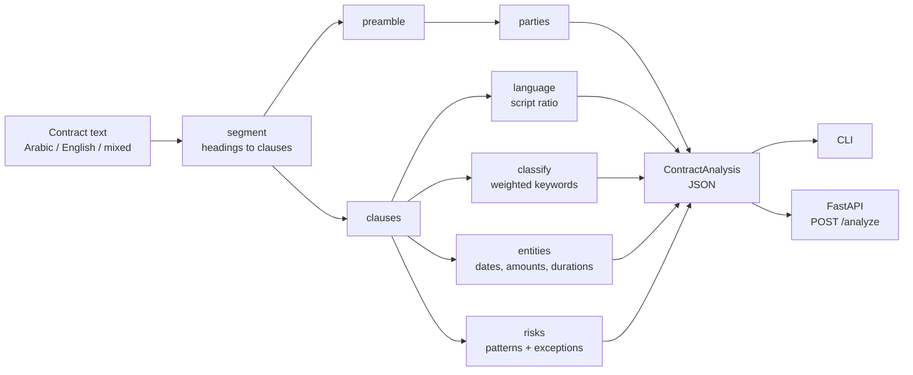

# clausekit

Bilingual Arabic/English contract clause extraction for Gulf legal documents.
A Python library, a CLI and a FastAPI endpoint that turn contract text into
structured JSON: numbered clauses, clause types, key entities and risk flags.

## Why

Contracts in Qatar, the UAE, Saudi Arabia and Bahrain are often drafted in
Arabic, in English, or in both side by side. Most open-source contract tooling
assumes English, Latin digits and `1.`-style numbering. Arabic contracts use
`المادة (٥)` or `البند الأول`, Arabic-Indic digits (`١٥٠٬٠٠٠`), optional
diacritics, tatweel and several spellings of the same letter, so naive keyword
matching misses most of them.

clausekit handles those details with a transparent, dependency-free rule
engine. Every decision it makes can be traced to a keyword or a pattern, which
matters when a lawyer asks why a clause was flagged.

## What it does

| Step | Arabic | English |
|---|---|---|
| Split into clauses | `المادة (٥)`, `المادة الخامسة`, `البند الأول`, `الفقرة الثانية عشرة` | `Article 5`, `Clause 3.1`, `Section IV`, `1.`, `2)`, `1.2` |
| Normalise | tatweel and diacritics removed; `أ إ آ ٱ → ا`, `ى → ي`, `ة → ه`; `٠-٩ → 0-9` | case folding |
| Detect language | per clause and per document: `ar`, `en`, `mixed` | |
| Classify | termination, confidentiality, governing law, payment, liability, force majeure, dispute resolution, or `other` | |
| Extract entities | dates (`١٥ مارس ٢٠٢٦`, `٠١/٠٤/٢٠٢٦`), amounts (`٢٥٬٠٠٠ ريال سعودي`), durations (`(٩٠) يوماً`, `سنتين`), parties (`الطرف الأول: …`) | dates (`12 January 2026`, `2026-02-01`), amounts (`QAR 150,000`, `$1,200`), durations (`thirty (30) days`), parties (`between X ("the Supplier") and Y`) |
| Flag risks | unlimited liability, automatic renewal, unilateral termination, with the matched wording as evidence | |

Currencies: QAR, AED, SAR, BHD and USD, by ISO code, symbol, English name or
Arabic name.

## Architecture



Every stage matches against a normalised copy of the text and keeps a
character index map back to the original. Matches are reported in the
original spelling, so `"evidence"` and entity `"text"` fields show exactly what
the contract says, Arabic-Indic digits and diacritics included.

```
src/clausekit/
  normalize.py   Arabic normalisation, digit mapping, index map
  segment.py     heading detection and clause splitting
  language.py    script-ratio language detection
  classify.py    bilingual weighted keyword classifier
  entities.py    dates, amounts, durations, parties
  risks.py       risk rules with exceptions
  extractor.py   the pipeline and the output model
  cli.py         command-line interface
  api.py         FastAPI application
```

## Quick start

```bash
git clone https://github.com/ahmedmahdy1420-cmd/clausekit.git && cd clausekit
python3 -m venv .venv && source .venv/bin/activate
pip install -e ".[api,dev]"
```

The core library has no third-party dependencies. FastAPI and uvicorn are only
needed for the HTTP endpoint.

### Library

```python
from clausekit import analyze

result = analyze(open("examples/service_contract_ar.txt", encoding="utf-8").read())

for clause in result.clauses:
    print(clause.number, clause.type, clause.title)

for risk in result.risks:
    print(risk.severity, risk.code, risk.clause_number, risk.evidence)

payload = result.to_dict()  # plain dicts and lists, ready for json.dumps
```

### CLI

```bash
clausekit analyze examples/supply_agreement_en.txt --pretty
clausekit analyze examples/service_contract_ar.txt --risks-only --pretty
cat examples/lease_bilingual.txt | clausekit analyze - -o lease.json
python -m clausekit analyze contract.txt --split-level 2
```

`--risks-only` on the Arabic sample:

```json
{
  "language": "ar",
  "parties": [
    {"name": "شركة الريان للاستشارات القانونية ذ.م.م", "role": "مقدم الخدمة"},
    {"name": "مؤسسة النخيل العقارية", "role": "العميل"}
  ],
  "risks": [
    {
      "code": "auto_renewal",
      "severity": "medium",
      "message": "Contract renews automatically; diarise the notice window.",
      "message_ar": "يتجدد العقد تلقائياً؛ يجب تسجيل مهلة الإخطار.",
      "evidence": "تجدد العقد تلقائياً",
      "clause_index": 2,
      "clause_number": "2"
    },
    {
      "code": "unilateral_termination",
      "severity": "high",
      "evidence": "إنهاء العقد يحق للعميل فسخ هذا العقد في أي وقت بإرادته المنفردة دون إبداء أسباب",
      "clause_number": "5"
    }
  ],
  "summary": {"clause_count": 9, "risk_count": 2, "high_risk_count": 1}
}
```

(Output shortened.) A full clause entry looks like this:

```json
{
  "index": 3,
  "kind": "clause",
  "number": "3",
  "heading": "المادة (٣): المقابل المالي",
  "title": "المقابل المالي",
  "level": 1,
  "language": "ar",
  "type": "payment",
  "confidence": 1.0,
  "type_scores": {"payment": 19.0},
  "entities": {
    "dates": [],
    "amounts": [{"text": "٢٥٬٠٠٠ ريال سعودي", "amount": "25000", "currency": "SAR"}],
    "durations": [{"text": "(١٥) يوماً", "value": 15, "unit": "day"}]
  }
}
```

### API

```bash
uvicorn clausekit.api:app --reload
```

```bash
curl -s localhost:8000/health

curl -s -X POST localhost:8000/analyze \
  -H 'Content-Type: application/json' \
  -d '{"text": "المادة (١): السرية\nيلتزم الطرفان بعدم إفشاء المعلومات.", "risks_only": false}'
```

Request fields: `text` (required, up to 500,000 characters), `split_level`
(1 to 4), `min_score`, `risks_only`. Interactive docs are served at `/docs`.

### Docker

```bash
docker build -t clausekit .
docker run --rm -p 8000:8000 clausekit
```

## Design decisions

- **Rules, not a model.** Clause headings and legal boilerplate are formulaic
  in both languages. A weighted keyword scorer is fast, deterministic, needs
  no training data and explains itself through `type_scores`. A statistical
  classifier can be added behind the same `classify_clause` interface later.
- **Normalise for matching, report the original.** Keywords are stored in
  normalised form (`انهاء`, `الماده`), so `إنهاء`, `إنـهـاء` and `إِنْهَاء` all
  match. An index map slices the original text back out for evidence and
  entities.
- **Substring matching for Arabic, word boundaries for English.** Arabic
  attaches prefixes (`و`, `ب`, `ل`, `ال`) to words, so `بالتحكيم` must still
  hit `تحكيم`. English uses `\b` so that `pay` does not fire inside `repay`.
- **Titles weigh three times the body.** The heading is the strongest signal
  a drafter gives. Repeated keywords count at most three times so a long
  clause does not drown a short, precise one.
- **Keyword headings own their sub-numbering.** When a contract uses
  `Article`/`المادة` headings, `5.1` and `5.2` stay inside Article 5. For
  documents that only use `1.`, `1.2`, `--split-level` sets the depth that
  starts a new clause.
- **Risk rules have exceptions.** "Liable for all losses" is not flagged when
  the same clause says "shall not exceed" or `بحد أقصى`. One flag per rule per
  clause keeps the output readable.
- **Day-first numeric dates.** `01/04/2026` is 1 April, as written in the Gulf.
  Impossible dates are dropped, not guessed.
- **Amounts as decimal strings.** `"25000"`, not a float, so money keeps its
  precision through JSON.

## Limitations

- **Not legal advice.** clausekit is a reading aid for people who review
  contracts. It does not interpret law, and a missing flag does not mean a
  clause is safe.
- Keyword rules miss unusual drafting and can misfire on clauses that discuss
  a topic in passing. Check `type_scores` and `confidence` before relying on a
  label.
- Hijri dates, amounts written in words (`خمسون ألف ريال`) and number words
  in English (`thirty days` without digits) are not extracted.
- Party extraction covers labelled lines (`الطرف الأول:`, `First Party:`) and
  the English `between … and …` sentence. Other preamble styles return an empty
  list.
- Input is plain text. PDF or DOCX extraction, OCR and table handling are out
  of scope.

## Running tests

```bash
python3 -m venv .venv
.venv/bin/pip install -e ".[dev]"
.venv/bin/pytest
.venv/bin/ruff check . && .venv/bin/ruff format --check .
```

The suite covers normalisation, Arabic and English heading styles, the
classifier in both languages, entity extraction in both digit systems, risk
rules and their exceptions, the CLI and the HTTP API. CI runs ruff and pytest
on Python 3.12.

## Licence

MIT. Copyright (c) 2026 Ahmed Mahdy. The sample contracts in `examples/` are
fictional.
